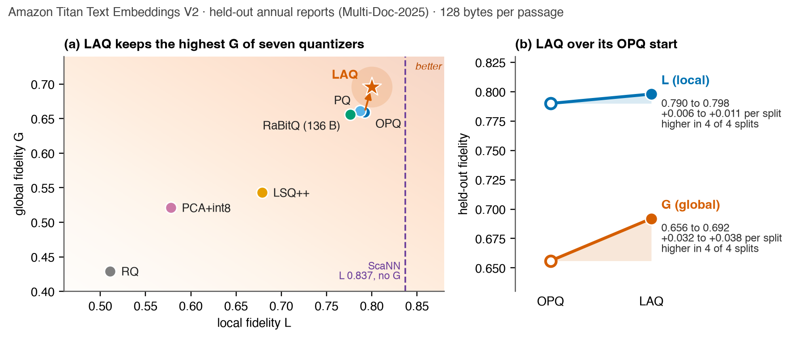
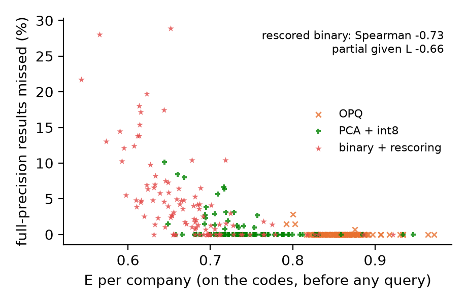
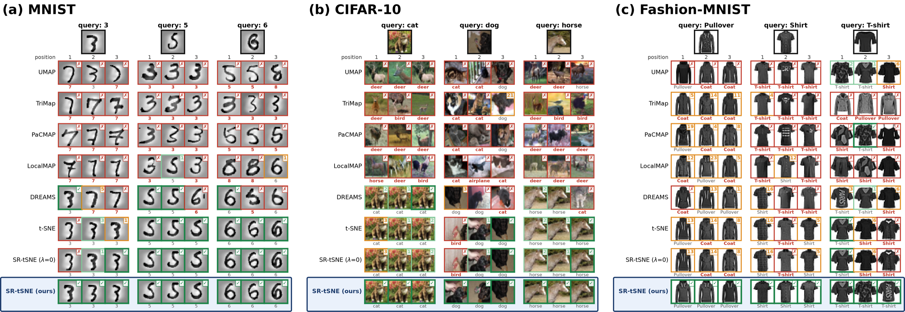
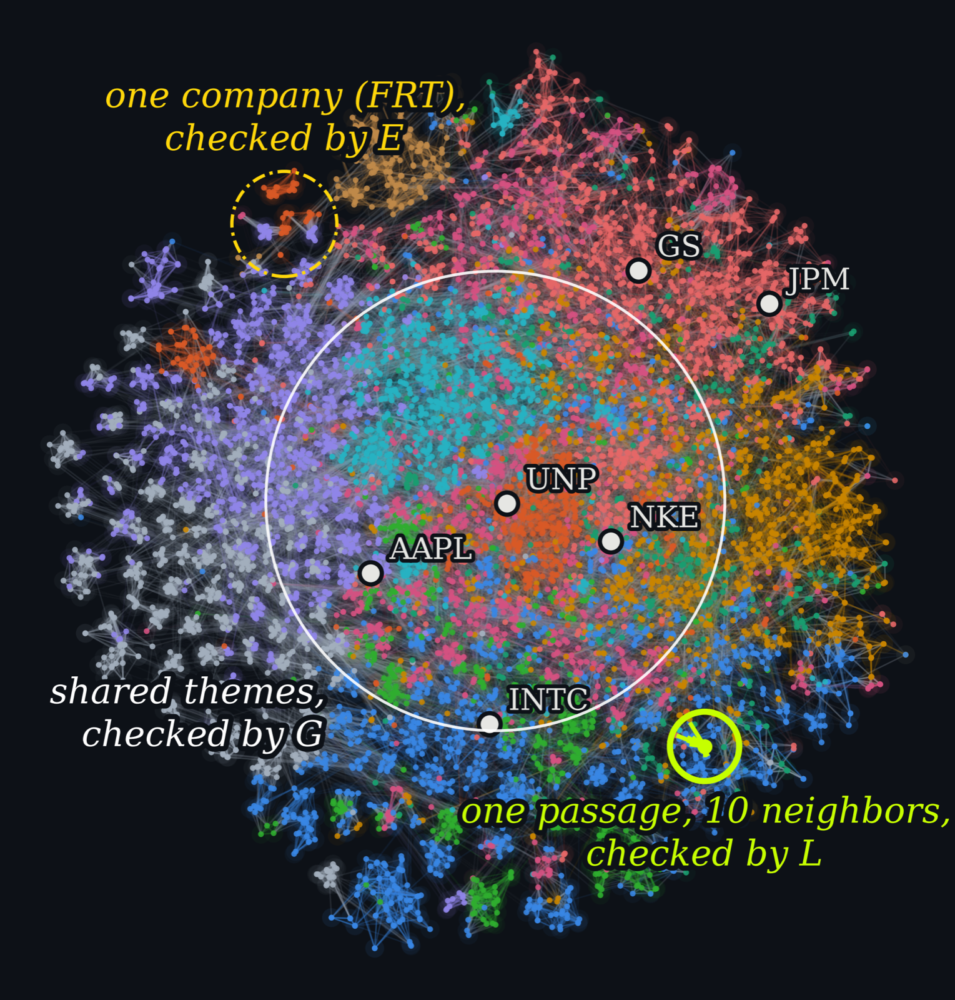

# Preprints for the Amazon Research Award proposal *MemCert*

**MemCert: Label-Free Certification of Compressed Memory for Enterprise Financial AI Agents**
Henry Han, Data Science and AI Innovation Laboratory, Baylor University · [Henry_Han@baylor.edu](mailto:Henry_Han@baylor.edu)

Three manuscripts under review, version of 2026-11-01. Together they supply the measure, the evidence, the repair method and the memory map on which the proposal builds.

| | Paper | PDF |
|---|---|---|
| 1 | H. Han. **Quantifying Local and Global Fidelity of Nonlinear Embeddings.** Manuscript under review, 2026. | [PDF](Han2026_Quantifying_Local_Global_Fidelity_Nonlinear_Embeddings.pdf) |
| 2 | H. Han. **Enhancing Local and Global Structure in Compressed AI Agent Memory.** Manuscript under review, 2026. | [PDF](Han2026_Enhancing_Local_Global_Structure_Compressed_Agent_Memory.pdf) |
| 3 | H. Han, L. Niu, D. Li, J. Wang. **Differential Rank Preservation Manifold Learning.** Manuscript under review, 2026. | [PDF](Han2026_Differential_Rank_Preservation_Manifold_Learning.pdf) |

## What each paper does for the proposal

An AI agent stores what it reads as embedding vectors and compresses them at scale. Today a compression is accepted when each item's nearest neighbors survive. Agents also consolidate, delete and compare what they store, and these operations depend on which items lie far apart. MemCert scores both ends of a compressed memory against the uncompressed memory.

| Proposal aim | What the papers already provide |
|---|---|
| **Aim 1.** Measure what each compression option keeps | Paper 1 defines the two scores: local fidelity *L* at 10 neighbors and global fidelity *G* over 30 to 50 percent of the data. Both are label-free and come from one chance-corrected curve. *G* agrees with established global scores (0.89 and 0.96 over 156 maps of twelve datasets), and 2,000 points estimate it. |
| **Aims 1 and 2.** Score each entity | Entity-scale fidelity *E* applies the same chance-corrected overlap with *k* equal to an entity's number of passages. On the codes, before any query, it flags the companies whose passages a compressed index misses (see *Entity-scale fidelity E* below). |
| **Aim 2.** Test which agent operations each score predicts | Paper 2 shows that retrieval follows *L* (partial rank correlation 0.83 to 0.99 given *G*). With the three retrieval-tuned encoders, consolidation and deletion follow *G* (0.55 to 0.93 given *L*). |
| **Aim 3.** Certify a memory and repair what the certificate flags | Paper 1 gives the LG reversal test, which decides with a block-jackknife *p*-value whether one map is more local and another more global. Paper 2 gives the repair: locality-aware quantization (LAQ) learns the codebooks of an OPQ index and keeps its bytes, rotation and search. LAQ raises *G* in all 40 held-out runs, Amazon Titan Text Embeddings V2 included. |
| **Aim 3.** Show a firm its memory | Paper 3 gives SR-tSNE, the map MemCert draws of a memory. It keeps each item's neighbors in their original order, so the items shown next to a passage are the ones a search would return first. |

## Paper 1. Quantifying Local and Global Fidelity of Nonlinear Embeddings

One curve gives both scores. The locality profile is the chance-corrected share of each point's *k* nearest neighbors that a map keeps, over all neighborhood sizes. Its value at *k* = 10 is *L*, and its mean over 30 to 50 percent of the data is *G*. The paper proves that at the midpoint the profile is the agreement on which half of the data is near each point, a rank correlation of the distances. In an agent memory of one million passages, the test finds that two maps cross at 150,000 passages (*p* = 2.6 × 10⁻⁵).

**Figure 1 (Fig. 1 of Paper 1).** On 70,000 MNIST digits, t-SNE keeps more of each point's neighbors and PCA keeps more of the global structure; the two cross at 20 percent of the data. (a) A point keeps 6 of its 10 nearest neighbors in the t-SNE map. (b) The raw overlap DLP*k* rises to 1 partly by chance (dashed line). (c) After the chance correction, *L* is the value at *k* = 10 (t-SNE 0.38, PCA 0.07) and *G* the mean over the gray band (PCA 0.30, t-SNE 0.20). (d, e) Each point's agreement on its near and far halves tracks the rank correlation of its distances (*r* = 0.94). (f) Seven maps in the (*L*, *G*) plane.

## Paper 2. Enhancing Local and Global Structure in Compressed AI Agent Memory

The paper proves that the loss at every neighborhood size is bounded by the rate of rank violations between near and far items. Keeping near and far pairs in order therefore keeps the far end. LAQ turns this bound into a training objective. On held-out companies and conversations it lifts the lowest theme agreement from 0.80 to 0.89 and has the highest *G* of seven quantizers of the same size in each of 12 runs.

**Figure 2 (Fig. 9 of Paper 2).** LAQ raises the far end of every held-out memory by lowering rank violations, and the gain reaches the operations that depend on the far end. (a) Profiles of OPQ and LAQ with Amazon Titan V2; the gray band is where *G* is measured. (b) The gain grows toward the far end for all four encoders. (c) The bound of Theorem 1 holds at every point. (d) LAQ lowers the rate of rank violations. (e) *G* rises in all 40 held-out runs. (f) Change in agreement for each agent operation; on the right, the number of runs in which LAQ is higher. (g) LAQ (black) and six other quantizers at the same size. (h) The lowest theme agreement rises from 0.80 to 0.89.

### Amazon Titan Text Embeddings V2

**Figure 3 (Tables 2 and 3 of Paper 2).** With Amazon Titan Text Embeddings V2, LAQ keeps the highest global fidelity of seven quantizers of the same size. Held-out annual reports of Multi-Doc-2025 at 128 bytes per passage. (a) *G* and *L* of each quantizer, means over three splits; RaBitQ uses 136 bytes, and ScaNN reports *L* only. (b) From its OPQ start, LAQ raises *G* from 0.656 to 0.692 and *L* from 0.790 to 0.798, in each of four splits.

**At a million passages (result after the manuscript).** On one million MS MARCO passages at 96 bytes, with LAQ trained on 100,000 other passages, *G* rises from 0.774 (OPQ) to 0.784 to 0.785 in all three seeds, with *L* and recall@10 within 0.002 of OPQ.

## Entity-scale fidelity *E* (result after the manuscripts)

Between *L* (10 neighbors) and *G* (30 to 50 percent of the data) lies the scale of one entity. *E* scores each company on the compressed codes: for each of its passages, the chance-corrected share of the passage's *k* nearest neighbors that the codes keep, with *k* equal to the company's number of passages.

We retrieved each of 106 S&P 500 companies in FinQA (BGE-base, 8,356 passages, 96 code bytes per passage) with the centroid of its passages, in a FAISS simulation of OpenSearch's on-disk default: max(2*k*, 100) candidates (oversampling 2.0 with OpenSearch's 100-candidate minimum), reranked at full precision. Rescored binary codes miss some of a company's own passages that full-precision search returns for 65 of 106 companies (223 passages), PCA+int8 for 6 and OPQ for 1. Across companies, *E* predicts the share of full-precision results missed better than *L* (Spearman −0.73 vs. −0.44). Given *L*, *E* keeps a partial rank correlation of −0.66 (95% bootstrap CI −0.76 to −0.52); given *E*, *L* adds −0.06.

**Figure 5.** Companies with low *E* lose a larger share of their full-precision results under rescoring. Each mark is one company and one compression at 96 code bytes per passage (FinQA, BGE-base).

## Paper 3. Differential Rank Preservation Manifold Learning

t-SNE and UMAP keep each point's neighbors but not their order. SR-tSNE adds a differentiable rank term to the t-SNE loss, so a point's true neighbors outrank intruders and keep their original order. Ordinal DLP (O-DLP) credits a neighbor only when it returns at its own rank. Across eight benchmarks of image, text, speech, remote-sensing and single-cell data, SR-tSNE outperforms 12 baselines in rank preservation and neighborhood overlap, gives the best label transfer on seven vision datasets, and ranks first in 17 of 18 single-cell dataset and metric combinations.

**Figure 4 (Fig. 6 of Paper 3).** SR-tSNE returns each query's nearest neighbors at their own rank, where other methods introduce ordinal and class errors. Top three embedded neighbors of queries from (a) MNIST, (b) CIFAR-10 and (c) Fashion-MNIST. Badges give the neighbor's rank in the original space within the query's top 30; frames show the rank displacement (dark green: exact; pale green: off by one; orange: off by two or more; red: outside the top 30). Class labels turn red on a class mismatch.

**Figure 6 (Figure 1 of the proposal).** The memory map MemCert draws with SR-tSNE: 8,356 FinQA passages of 106 S&P 500 companies in 11 theme colors. A recall check sees one passage's 10 nearest neighbors (*L*, green) but misses a whole company (*E*, gold) and themes shared across companies (*G*, white).

## Contact

Henry Han, Baylor University · [Henry_Han@baylor.edu](mailto:Henry_Han@baylor.edu)
