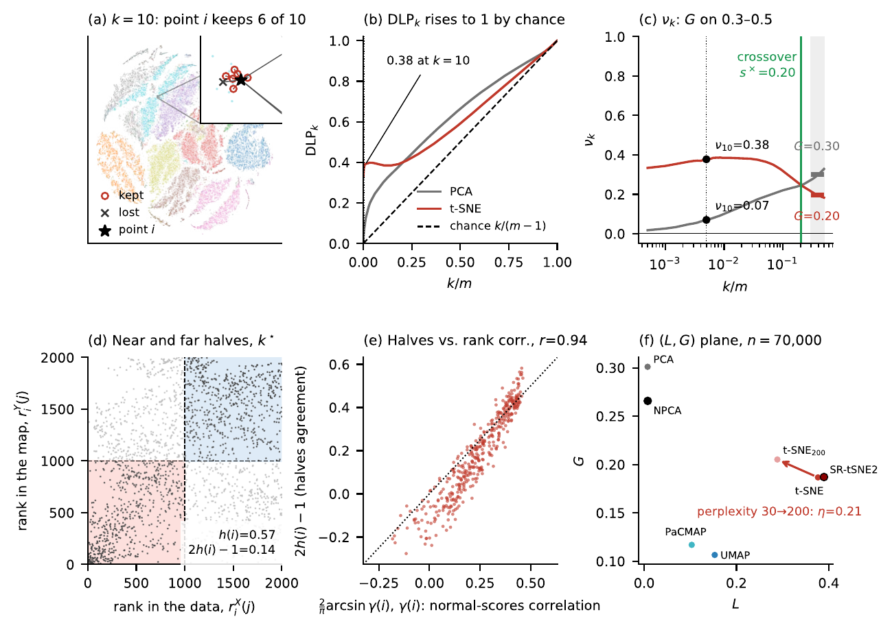
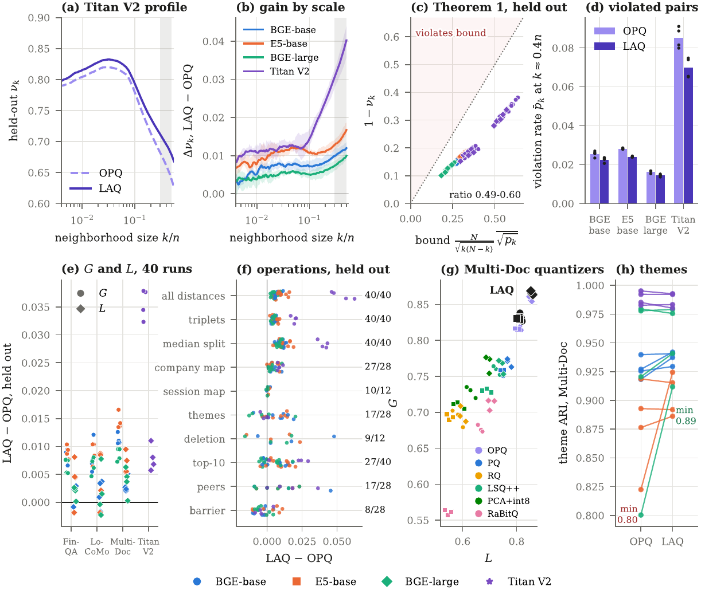

# Preprints for the Amazon Research Award proposal *MemCert*

**MemCert: Label-Free Certification of Compressed Memory for Enterprise Financial AI Agents**
Henry Han, Data Science and AI Innovation Laboratory, Baylor University · [Henry_Han@baylor.edu](mailto:Henry_Han@baylor.edu)

Two manuscripts under review, version of 2026-10-31. Together they supply the measure, the evidence and the repair method on which the proposal builds.

| | Paper | PDF |
|---|---|---|
| 1 | H. Han. **Quantifying Local and Global Fidelity of Nonlinear Embeddings.** Manuscript under review, 2026. | [PDF](Han2026_Quantifying_Local_Global_Fidelity_Nonlinear_Embeddings.pdf) |
| 2 | H. Han. **Enhancing Local and Global Structure in Compressed AI Agent Memory.** Manuscript under review, 2026. | [PDF](Han2026_Enhancing_Local_Global_Structure_Compressed_Agent_Memory.pdf) |

## What each paper does for the proposal

An AI agent stores what it reads as embedding vectors and compresses them at scale. Today a compression is accepted when each item's nearest neighbors survive. Agents also consolidate, delete and compare what they store, and these operations depend on which items lie far apart. MemCert scores both ends of a compressed memory against the uncompressed memory.

| Proposal aim | What the papers already provide |
|---|---|
| **Aim 1.** Measure what each compression option keeps | Paper 1 defines the two scores: local fidelity *L* at 10 neighbors and global fidelity *G* over 30 to 50 percent of the data. Both are label-free and come from one chance-corrected curve. *G* agrees with established global scores (0.89 and 0.96 over 156 maps of twelve datasets), and 2,000 points estimate it. |
| **Aim 2.** Test which agent operations each score predicts | Paper 2 shows that retrieval follows *L* (partial rank correlation 0.83 to 0.99 given *G*). With the three retrieval-tuned encoders, consolidation and deletion follow *G* (0.55 to 0.93 given *L*). |
| **Aim 3.** Certify a memory and repair what the certificate flags | Paper 1 gives the LG reversal test, which decides with a block-jackknife *p*-value whether one map is more local and another more global. Paper 2 gives the repair: locality-aware quantization (LAQ) learns the codebooks of an OPQ index and keeps its bytes, rotation and search. LAQ raises *G* in all 40 held-out runs, Amazon Titan Text Embeddings V2 included. |

## Paper 1. Quantifying Local and Global Fidelity of Nonlinear Embeddings

One curve gives both scores. The locality profile is the chance-corrected share of each point's *k* nearest neighbors that a map keeps, over all neighborhood sizes. Its value at *k* = 10 is *L*, and its mean over 30 to 50 percent of the data is *G*. The paper proves that at the midpoint the profile is the agreement on which half of the data is near each point, a rank correlation of the distances. In an agent memory of one million passages, the test finds that two maps cross at 150,000 passages (*p* = 2.6 × 10⁻⁵).

**Figure 1 (Fig. 1 of the paper).** On 70,000 MNIST digits, t-SNE keeps more of each point's neighbors and PCA keeps more of the global structure; the two cross at 20 percent of the data. (a) A point keeps 6 of its 10 nearest neighbors in the t-SNE map. (b) The raw overlap DLP*k* rises to 1 partly by chance (dashed line). (c) After the chance correction, *L* is the value at *k* = 10 (t-SNE 0.38, PCA 0.07) and *G* the mean over the gray band (PCA 0.30, t-SNE 0.20). (d, e) Each point's agreement on its near and far halves tracks the rank correlation of its distances (*r* = 0.94). (f) Seven maps in the (*L*, *G*) plane.

## Paper 2. Enhancing Local and Global Structure in Compressed AI Agent Memory

The paper proves that the loss at every neighborhood size is bounded by the rate of rank violations between near and far items. Keeping near and far pairs in order therefore keeps the far end. LAQ turns this bound into a training objective. On held-out companies and conversations it lifts the lowest theme agreement from 0.80 to 0.89 and has the highest *G* of seven quantizers of the same size in each of 12 runs.

**Figure 2 (Fig. 9 of the paper).** LAQ raises the far end of every held-out memory by lowering rank violations, and the gain reaches the operations that depend on the far end. (a) Profiles of OPQ and LAQ with Amazon Titan V2; the gray band is where *G* is measured. (b) The gain grows toward the far end for all four encoders. (c) The bound of Theorem 1 holds at every point. (d) LAQ lowers the rate of rank violations. (e) *G* rises in all 40 held-out runs. (f) Change in agreement for each agent operation; on the right, the number of runs in which LAQ is higher. (g) LAQ (black) and six other quantizers at the same size. (h) The lowest theme agreement rises from 0.80 to 0.89.

## Contact

Henry Han, Baylor University · [Henry_Han@baylor.edu](mailto:Henry_Han@baylor.edu)
